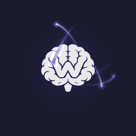
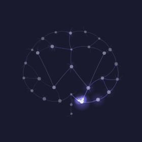
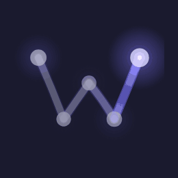

# Activity indicator candidates

Directions explored for the side panel's working indicator, the animation next to
"Thinking…". One of them shipped; the others are kept here so they can be reused
elsewhere, such as empty states, onboarding, the website or the companion app.

Open `index.html` in a browser to see all of them animating, large and at their real
size in the activity bar, in the dark and light themes. It has an accent switch
(UI violet, logo pink, mono) and a speed slider. The colors are the side panel's
theme tokens, and the mark is traced from `assets/logo-mark.png`.

## B · Nucleus



The mono mark as a nucleus. Sparks whizz on 3D orbits that slowly precess, passing
behind the brain and back out in front of it; short-lived sparks arrive from random
angles, and at large sizes embers flick off their heads. The mark keeps it
recognizable at 22px. It is the most energetic of the set, which suits short moments
(a model downloading, a cloud run starting) better than a bar that can stay up for
minutes.

## A · Neural circuit



The mark redrawn as neurons: the traced outline, the central fissure, the stem and
the W. Neurons fire and pass signals along the axons in cascades, and a signal keeps
re-tracing the W. Meant for 48px and up, for example an empty chat or onboarding
while models load; below that the circuit turns into noise.

## A · W only



The circuit reduced to its spine for small sizes: the signal runs the W end to end
and its neurons flash. Shown here at 10×.

## Shipped: brain outline

The W inside the brain's traced outline, which brightens as the signal passes. The
production code is `src/chrome/src/ui/activity-brain.js` (mirrored in
`src/firefox/`): a trimmed version of `WBLoaders.synapse(…, { variant: 'brain' })`
that reads its colors from the theme, runs only while the bar is visible and holds a
still frame under `prefers-reduced-motion`.

## Files

- `index.html`: the demo page.
- `loaders.js`: the canvas engine for every candidate (`WBLoaders.synapse`,
  `WBLoaders.nucleus`), no dependencies. Its header comment lists the options.
- `marks.js`: the mono mark as SVG path data (`WB_MARKS.detail`, `WB_MARKS.small`).
- `webbrain-mark-mono.svg`, `webbrain-mark-mono-small.svg`: the same marks as
  standalone SVGs filled with `currentColor`. The small one opens up the grooves so
  the W still reads at 32px and below.
- `preview-*.gif`: the previews above.

## Using one

```html
<canvas id="loader" style="width: 160px; height: 160px"></canvas>
<script src="marks.js"></script>
<script src="loaders.js"></script>
<script>
  const canvas = document.getElementById('loader');
  // The bitmap sets the pixel density: the engine draws in a 160px layout.
  canvas.width = canvas.height = 160 * Math.max(2, devicePixelRatio);
  const loader = WBLoaders.nucleus(canvas, {
    size: 160, theme: 'dark', mark: WB_MARKS.detail, markSmall: WB_MARKS.small,
  });
  (function loop(now) { loader.frame(now); requestAnimationFrame(loop); })(performance.now());
</script>
```

Before shipping one in the extension, do what `activity-brain.js` does: animate only
while it is visible, hold a still frame under reduced motion, and take its colors
from the theme tokens.
