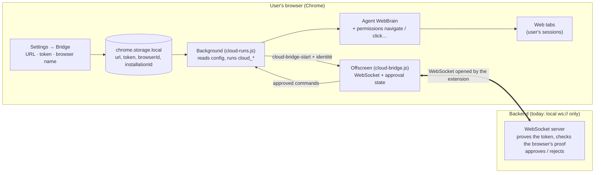

# Cloud Bridge browser registration & approval

A backend can require explicit approval of a WebBrain installation before it is allowed to run `cloud_*` commands. The feature is opt-in: **without a Cloud Bridge token the bridge behaves exactly as before** (local MCP server, no approval step).

With a token, the backend and the browser first authenticate each other with a challenge-response over the token. The token itself never crosses the socket, so a program that takes the loopback port before the real backend learns nothing it can reuse and cannot get the browser to run commands.

## Architecture

```
background (cloud-runs.js)  --cloud-bridge-start {url, token, browserId, installationId, extensionVersion, legacyBearerAuth}-->  offscreen (cloud-bridge.js)  <== WebSocket ==>  backend
```



The French guide ([cloud-bridge-test-guide.fr.md](cloud-bridge-test-guide.fr.md)) also has a message-sequence diagram.

**Chrome vs Firefox.** Chrome (MV3) hosts the socket in an offscreen document (`src/chrome/src/offscreen/cloud-bridge.js`). Firefox (MV2) has no offscreen documents, so `src/firefox/src/cloud-bridge.js` is a module that runs in the persistent background page and hands commands directly to `handleMessage`. The protocol, storage keys, approval rules and Settings tab are identical; `src/firefox/src/cloud-runs.js` mirrors the Chrome controller and receives the bridge as an injected dependency.

- `cloud-runs.js` reads the persistent identity from `chrome.storage.local` and passes it to the offscreen page with the existing `cloud-bridge-start` message (the offscreen page has no storage access).
- `offscreen/cloud-bridge.js` sends the enriched `hello`, runs the challenge-response and tracks the authentication and approval state **per socket**.
- Command routing (`cloud_run`, `cloud_status`, `cloud_respond`, `cloud_abort`, workflows, scheduled jobs) and payloads are unchanged.

## Local configuration

Keys in `chrome.storage.local` (the existing mechanism; the URL and enable toggle are already in Settings):

| Key | Meaning |
| --- | --- |
| `webbrainCloudBridgeEnabled` | existing toggle |
| `webbrainCloudBridgeUrl` | existing, `ws://` on localhost only |
| `webbrainCloudBridgeToken` | Cloud Bridge credential. Distinct from provider API keys. Setting it turns approval on. |
| `webbrainCloudBridgeBrowserId` | Backend-visible name; defaults to the installation id |
| `webbrainCloudBridgeInstallationId` | Generated once (`crypto.randomUUID()`) |
| `webbrainCloudBridgeLegacyBearerAuth` | Deprecated. Only the boolean `true` turns it on; see [Legacy bearer hello](#legacy-bearer-hello-deprecated). Not shown in Settings. |

All of these except the legacy flag are editable in **Settings → Bridge**: enable toggle, backend URL, token, browser name (`browserId`), the read-only installation ID, and a **Save & test connection** button. The test saves the form, (re)starts the bridge and reports one of: backend unreachable, connected (no approval needed), waiting for approval, approved, or rejected (with the reason).

To try it end to end: run `node examples/cloud-bridge-approval-server.mjs --token dev-token`, enter `dev-token` in the tab, press **Save & test connection** (status: waiting for approval), then type `approve` in the server terminal (status: approved) or `reject`.

The older Display → MCP block controls the same enable/URL keys; it is not refreshed live when the new tab changes them (reload Settings).

Changing the token, browserId or legacy flag reconnects the socket.

## Messages

### 1. Extension → backend: `hello` (every socket open)

```json
{
  "type": "hello",
  "client": "webbrain-extension",
  "protocolVersion": 2,
  "capabilities": ["saved_workflows_v1", "run_modes_v1", "scheduled_jobs_v1", "run_provider_v1", "private_results_v1", "bot_memory_v1", "run_handoff_v1"],
  "auth": { "type": "challenge", "method": "hmac-sha256-v1", "nonce": "<64 lowercase hex chars>" },
  "browser": { "name": "Chrome", "version": "126.0.0.0" },
  "extensionVersion": "40.2.1",
  "platform": "Linux x86_64",
  "status": { "enabled": true, "approval": "pending", "…": "…" }
}
```

`auth` is only sent when a token is configured. `nonce` is 32 fresh random bytes per socket. The hello carries neither the token nor `browserId` / `installationId` (they are also removed from its `status`); those come in step 3, after the backend has proved itself. Without a token the hello is unchanged from earlier versions (no `auth`; `status` keeps both IDs).

### 2. Backend → extension: `auth_challenge`

```json
{ "type": "auth_challenge", "method": "hmac-sha256-v1", "nonce": "<64 lowercase hex chars>", "proof": "<64 lowercase hex chars>" }
```

`nonce` is the backend's own 32 random bytes. `proof` is

```
hex(HMAC-SHA256(key = UTF-8(token), message = UTF-8(JSON.stringify(["webbrain-bridge-auth-v1", "controller", helloNonce, backendNonce]))))
```

`JSON.stringify` of a string array has no whitespace, for example `["webbrain-bridge-auth-v1","controller","ab…","cd…"]`. The extension answers only the first `auth_challenge` of a socket. If the method, either nonce or the proof is wrong it sends nothing back, closes the socket, reports `Bridge controller failed authentication` and reconnects with the usual backoff (the real backend may get its port back). It is not a rejection.

### 3. Extension → backend: `auth_response`

```json
{ "type": "auth_response", "method": "hmac-sha256-v1", "proof": "<64 lowercase hex chars>", "browserId": "my-laptop", "installationId": "0b0c6a3e-…" }
```

`proof` is the same HMAC over `["webbrain-bridge-auth-v1", "extension", helloNonce, backendNonce, browserId, installationId]`. The backend recomputes it with its token (compare in constant time) and rejects the browser if it does not match. The role label stops either side from replaying the other's proof, and the nonces stop a recorded proof from working on another socket.

Test vector: token `secret-token`, hello nonce `00` × 32, backend nonce `11` × 32, `browserId` `browser-1`, `installationId` `install-1` give the backend proof `04734662625940a90c0e3aeed5a653b6fb2e24779baa71b6dccab394601937d4` and the extension proof `5670c5e30c40e94ed27cd0e99148310d44a3efe54d668b2f9fd21efe9a8e913e`.

### 4. Backend → extension: approval

```json
{ "type": "connection_pending",  "browserId": "my-laptop" }
{ "type": "connection_approved", "browserId": "my-laptop" }
{ "type": "connection_rejected", "browserId": "my-laptop", "reason": "Rejected by user" }
```

- With a token, `connection_pending` and `connection_approved` are ignored until the backend's `auth_challenge` has been verified. Send them after a valid `auth_response`.
- `connection_rejected` is honoured at any point, since it only takes rights away.
- `browserId` is optional; if present and different from the local one, the message is ignored.
- `connection_rejected` closes the socket and **stops auto-reconnect** until the settings change or the bridge is restarted.

Until `connection_approved`, any `cloud_*` command gets (and is not forwarded to the background):

```json
{ "id": "c1", "ok": false, "error": "Connection not approved", "code": "connection_not_approved", "status": 403 }
```

After approval, commands are exactly the existing format:

```json
{ "id": "c2", "action": "cloud_status", "payload": { "runId": "run_123" } }
```

`status().approval` is one of `not_required | pending | approved | rejected`.

`bot_memory_v1` enables a private, run-scoped `taskMemory` envelope on
`cloud_run`. It does not add general storage or configuration commands to the
socket. See [managed bot memory](cloud-bot-memory.md) for the guarded action
contract, credential handling, and image-upgrade checks.

## Reconnection

Authentication and approval belong to one WebSocket. Every new socket (reconnect, URL/identity change) starts `pending`, resends `hello` with a new nonce, and must pass the challenge and be approved again. With a token, the reconnect backoff is only reset once the backend has proved itself, so a program that keeps failing the challenge is retried at most every 30 seconds.

## Legacy bearer hello (deprecated)

Before the challenge-response, a token-configured hello carried `"auth": { "type": "bearer", "token": "…" }` plus `browserId` and `installationId`, and the extension accepted `connection_approved` from whoever answered. A backend that has not implemented steps 2 and 3 yet sees a hello without a token and should refuse it.

To keep such a backend working during the transition, set the flag by hand in the extension's console (service worker console on Chrome, background page console on Firefox):

```js
chrome.storage.local.set({ webbrainCloudBridgeLegacyBearerAuth: true })   // Firefox: browser.storage.local
```

With the flag the extension sends the old bearer hello and accepts unauthenticated approval messages, exactly as before. It hands the token to whatever listens on the configured port, so use it only until the backend implements the challenge, then remove it with `chrome.storage.local.remove('webbrainCloudBridgeLegacyBearerAuth')`. The flag will be removed in a later release.

## Implementing a backend

1. On `hello` with `auth.type === "challenge"` and `auth.method === "hmac-sha256-v1"`, check that `auth.nonce` is 64 lowercase hex characters, generate 32 random bytes of your own, and send `auth_challenge` with your proof. Answer each socket's hello once.
2. On `auth_response`, recompute the extension's proof from both nonces and the `browserId` / `installationId` in the message, compare in constant time, and reply `connection_rejected` (and close) on a mismatch.
3. Only then treat the socket as the browser: send `connection_pending` / `connection_approved`, and route `cloud_*` commands to it.
4. Optionally, during a transition, also accept the deprecated bearer hello (constant-time compare of `auth.token`) for extension builds that predate the challenge.

The example server below is a complete reference.

## Local test server

`examples/cloud-bridge-approval-server.mjs` is a dependency-free backend for testing:

```bash
node examples/cloud-bridge-approval-server.mjs --token dev-token          # manual approval
node examples/cloud-bridge-approval-server.mjs --token dev-token --auto-approve
node examples/cloud-bridge-approval-server.mjs --token dev-token --legacy-bearer   # also accept the deprecated bearer hello
```

It runs the challenge-response and replies `connection_pending` after a valid `auth_response` (or `connection_rejected` for a bad proof or an unexpected hello). If its token differs from the browser's, the browser drops it first (`Bridge controller failed authentication`). On stdin, type `approve`, `reject`, or `send {"id":"1","action":"cloud_status","payload":{"runId":"run_x"}}`.

Automated tests (unit with a fake WebSocket + one end-to-end run against that server):

```bash
npm run test:cloud-bridge-approval
```

## Limits & security

- The bridge URL is still restricted to `ws://` on localhost/127.0.0.1/::1. A remote backend needs a local relay, or a deliberate relaxation (needs TLS and a decision upstream).
- The token never travels over the socket (unless the deprecated legacy flag is set); it is stored in plain `chrome.storage.local` like other settings. Use a long random token: any program that can connect to the real backend can collect its proofs and try to guess a weak token offline.
- The backend is responsible for verifying the browser's proof and for the user-facing approval UI; the extension enforces "no proof from the backend, no identity and no approval" and "no approval, no commands".
- **Without a token there is no authentication.** Any program that listens on the configured port first, such as another user's process on a shared machine, can send `cloud_*` commands to the browser and read their results. This mode exists for the local MCP server, the LM Studio plugin and WebBrain Cloud, which do not use a token today; it is only active after the user (or the Cloud image) turns the bridge on.
- The extension still only accepts the `cloud_*` run actions; no cookies, tabs, history, provider keys or configuration are exposed.
- Approval is not persisted and not revocable from the extension side other than by disabling the bridge or rotating the token.
